# jsondeck

[](LICENSE)
[](CHANGELOG.md)
[](https://www.jsdelivr.com/package/gh/khanakia/jsondeck)
[](#typescript)

**jsondeck turns JSON into an interactive dashboard with one `<script>` tag.** Give it an array of objects and it builds a compact data table with search, filters, multi-column sort, pagination, grouping, saved views, column controls and copy/export. Add a small config and the same JSON also gives you charts, stat tiles, key-value cards, linked tables (master-detail, drill-down) and multi-page layouts with sections and grids. It is a JSON viewer, a data grid and a dashboard builder loaded from the jsDelivr CDN with one tag, with no build step, no server and no network calls of its own. It loads only what a page uses: a plain table page downloads about 115 kB of JavaScript, React included, and charts, menus or the date calendar load the first time they are needed. For pages opened from disk (`file://`) there is a single offline file, `jsondeck.full.js`.

```html
<script src="https://cdn.jsdelivr.net/gh/khanakia/jsondeck@v0.1.0/dist/jsondeck.js"></script>

<script type="application/json" id="data">{ "hosts": [ { "ip": "10.0.0.1", "status": "up" } ] }</script>
<div id="app"></div>
<script>
  JsonDeck.mount('#app', { data: '#data' })
</script>
```

With no config, column types, labels, filters and paging are guessed. Every part can be overridden through config, and TypeScript users get a typed `defineConfig(data, config)`.

## Contents

- [Why jsondeck?](#why-jsondeck)
- [Install](#install)
- [Files and sizes](#files-and-sizes)
- [Browser support](#browser-support)
- [TypeScript](#typescript)
- [Screenshots](#screenshots)
- [FAQ](#faq)
- [Development](#development)
- [How to release](#how-to-release)
- [Next tasks](#next-tasks)
- [Contributing, security and license](#contributing-security-and-license)

## Why jsondeck?

Most JSON that people want to look at (server lists, inventories, audit results, exports from an API) ends up in a hand-written HTML page or a spreadsheet. A hand-written page usually has no filters, breaks on the next data change and is rebuilt from scratch every time. Table libraries fix the table part, but you still write the page, the charts and the glue between them.

jsondeck is for the case where you have JSON and want a usable, good-looking view of it in minutes:

- **Zero config first.** Column types (numbers, dates, booleans, status values, IPs, URLs, tags) are guessed from the data, so `mount('#app', { data })` already gives a full table. Config only changes what the guess got wrong.
- **A dashboard, not only a grid.** Charts, stat tiles, cards and Markdown read the same data as the tables, and clicking a chart filters the page.
- **Power-user tables.** 28px rows, keyboard shortcuts, quick filters, saved views, grouping with totals, right-click copy as JSON, CSV, TSV or Markdown.
- **Small first load.** One script tag; the parts a page does not use are never downloaded. No telemetry, and a single offline file for `file://` pages.
- **Typed.** `defineConfig(data, config)` checks table and column names against your data, so a typo is a type error.

## Install

jsondeck is served from GitHub through jsDelivr. Always pin the version tag (`@v0.1.0`) so a later release never changes your page. It is not on npm; that may come later.

### Script tag (recommended)

```html
<script src="https://cdn.jsdelivr.net/gh/khanakia/jsondeck@v0.1.0/dist/jsondeck.js"></script>
```

`jsondeck.js` is a small loader (1.7 kB gzipped) that sets the global `JsonDeck`. It fetches the core (React and the table) from next to itself, plus every other part only when the page uses it: charts and stat tiles when one is on the page, menus and popovers on the first hover or click, the date calendar when a date filter opens, the row drawer, the layout editor, the code view and site search (see [Files and sizes](#files-and-sizes)). It also links `jsondeck.css` unless the page already links it; linking it yourself in `<head>` lets it start loading sooner:

```html
<link rel="stylesheet" href="https://cdn.jsdelivr.net/gh/khanakia/jsondeck@v0.1.0/dist/jsondeck.css">
```

Calls made right after the tag work: `JsonDeck.mount` and `JsonDeck.example` wait for the core and return their handle at once (`issues` fills in and `handle.ready` resolves once rendered). `setTheme`, `pageTheme`, `defineConfig` and `version` work at once too. The rest of the API (`describe`, `htmlSnippet`, `toSource`, `THEME_TOKENS` and the other constants) is there after `await JsonDeck.ready`; before that it throws an error that says so.

### One file, for offline and `file://` pages

```html
<script src="https://cdn.jsdelivr.net/gh/khanakia/jsondeck@v0.1.0/dist/jsondeck.full.js"></script>
```

Everything in one file, CSS included: it adds one `<style data-jsondeck>` to the page head (skipped when the page links `jsondeck.css`) and fetches nothing, so it works from a page opened with `file://`. Use it there: browsers block module loading on `file://` pages, so `jsondeck.js` cannot load its parts and shows a message pointing at this file instead. It is bigger (237 kB gzipped), since nothing is left out.

### ES module (bring your own React)

`dist/jsondeck.mjs` leaves `react` and `react-dom` (18 or later) to your page or app, so React is not shipped twice. It splits the same way as the script: the core is `dist/esm/core.js` (45.6 kB gzipped without React), and the other parts load from `dist/esm/` with plain `import()` when first used. With React from an ESM CDN through an import map (`?external=react` makes react-dom use the same React copy):

```html
<script type="importmap">
{ "imports": {
  "react": "https://esm.sh/react@19.2.0",
  "react/jsx-runtime": "https://esm.sh/react@19.2.0/jsx-runtime",
  "react-dom": "https://esm.sh/react-dom@19.2.0?external=react",
  "react-dom/client": "https://esm.sh/react-dom@19.2.0/client?external=react"
} }
</script>
<link rel="stylesheet" href="https://cdn.jsdelivr.net/gh/khanakia/jsondeck@v0.1.0/dist/jsondeck.css">
<div id="app"></div>
<script type="module">
  import { mount } from 'https://cdn.jsdelivr.net/gh/khanakia/jsondeck@v0.1.0/dist/jsondeck.mjs'
  mount('#app', { data: { hosts: [{ ip: '10.0.0.1', status: 'up' }] } })
</script>
```

Browsers do not run module scripts from `file://`, so the ES module needs a page served over http(s).

## Files and sizes

What a page downloads, measured from the browser's network log by `scripts/verify-cdn.mjs` (gzip level 9, JavaScript only; `jsondeck.css` adds 10.2 kB):

| Page | JavaScript on first load |
|---|---|
| Plain zero-config table, `jsondeck.js` | 114.6 kB (loader, entry, core with React); it was 219 kB before the split |
| The demo dashboard (stat tiles, charts, facets, a table), `jsondeck.js` | 125 kB (adds the stat tile and chart chunks) |
| Any page, `jsondeck.full.js` | 237 kB (everything, CSS included) |

The files:

| File | What it is | gzip |
|---|---|---|
| `dist/jsondeck.js` | the `<script>` loader (global `JsonDeck`); fetches what follows from next to itself | 1.7 kB |
| `dist/chunks/index.js` + `core.js` + `rolldown-runtime.js` | the core every page loads: React, React DOM, the table, config resolution, toolbar | 112.9 kB |
| `dist/jsondeck.full.js` | the single offline file: everything, CSS included, nothing fetched (`file://` pages) | 236.9 kB |
| `dist/jsondeck.css` | the stylesheet (`jsondeck.js` links it unless the page does) | 10.2 kB |
| `dist/jsondeck.mjs` + `dist/esm/core.js` | ES module core, React from your app | 45.9 kB |

The on-demand chunks in `dist/chunks/` (the same split exists in `dist/esm/` for the ES module, without React):

| Chunk | gzip | Loaded when |
|---|---|---|
| `popups.js` | 60.8 kB | first hover, focus or click on a toolbar control (filter, sort, columns, views, group by, more, export), a column header menu or rows-per-page; a filter pill; the shortcuts dialog. Holds Base UI (menus, popovers, dialogs) and those controls |
| `shared-daterangecontrol-datecontrol.js` + `daterangecontrol.js` + `datecontrol.js` | 22.0 kB | a date filter is opened (the calendar: react-day-picker and date-fns) |
| `shared-stattile-chart.js` + `shared-group-keyvaluecard-stattile-chart.js` + `stattile.js` + `keyvaluecard.js` | 10.7 kB | a chart, stat tile or key-value card is on the page (charts, sparklines, aggregation) |
| `markdown.js` + `shared-codeview-markdown.js` + `shared-searchdialog-markdown.js` | 7.4 kB | a Markdown item (callouts, steps, heading anchors, code fences) |
| `shared-codeview-markdown.js` | 2.5 kB | a Preview / Code box (`code: true`, `JsonDeck.example`): the code view and highlighter |
| `contextmenu.js` + `clipboard.js` | 3.2 kB | right-click on a row (the copy formats also load when rows are selected) |
| `searchdialog.js` | 2.0 kB | decks with site search, once the page is idle |
| `edittools.js` + `shared-edittools-layout-edit.js` | 2.7 kB | the layout editor is switched on |
| `rowfeatures.js` | 1.8 kB | a table with `quickFilters`, or rows get selected (selection bar) |
| `rowdrawer.js` | 1.6 kB | a row or a link to a related row is opened in the drawer |
| `rowdetail.js` | 1.4 kB | a row is expanded (detail fields, nested tables) |
| `toc.js` | 1.1 kB | an "On this page" outline |
| `group.js` | 0.7 kB | a table is grouped |
| `issuesbox.js` | 0.5 kB | the config has issues |
| `shared-*.js` (seven files under 1 kB each) | | small pieces two of the parts above share |

Every file has a `.map` source map beside it, and `dist/types/` holds the type definitions. jsDelivr serves gzip or brotli (brotli is about 15% smaller). Measure with `node scripts/size.mjs`; see what is inside each chunk with `pnpm analyze` and `node scripts/chunk-report.mjs`. Most of the core is React DOM (about 60 kB gzipped); the table engine, config resolution and the toolbar make up the rest.

## Browser support

Current Chrome, Edge, Firefox and Safari: Chrome and Edge 111+, Firefox 128+, Safari 16.4+ (the floor set by Tailwind CSS v4's CSS features and the build target). No Internet Explorer.

## TypeScript

`dist/types/` ships the `.d.ts` files for every public type. `defineConfig(data, config)` infers table and column names from your data, so unknown names fail type checking:

```ts
import { defineConfig, mount } from './jsondeck.mjs'

const hosts = [{ ip: '10.0.0.1', status: 'up', cpu: 12.5 }]
const config = defineConfig({ hosts }, {
  tables: { hosts: { columnOrder: ['ip', 'status', 'cpu'], columns: { cpu: { format: 'number:1' } } } },
})
mount('#app', config)
```

## Screenshots

All screenshots use fake demo data. Regenerate them with `node scripts/screenshots.mjs <preview-url>`.

| Dashboard (light) | Dashboard (dark) |
|---|---|
| 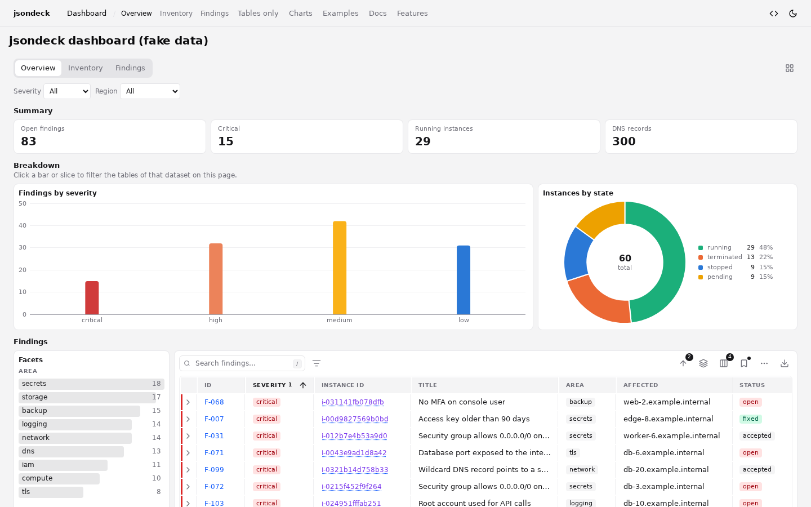 | 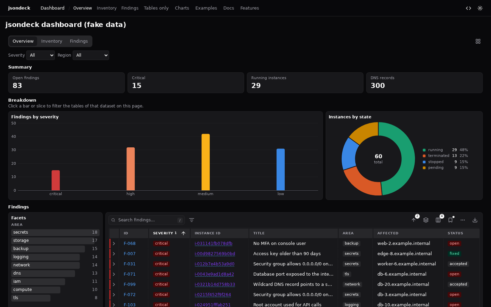 |

| Expanded row with nested drill-down | Right-click menu: copy as JSON / CSV / TSV / Markdown |
|---|---|
| 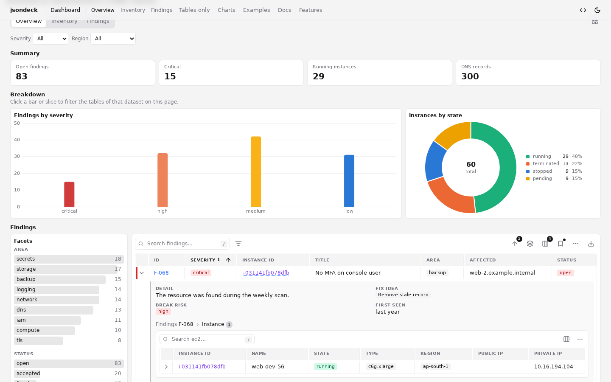 | 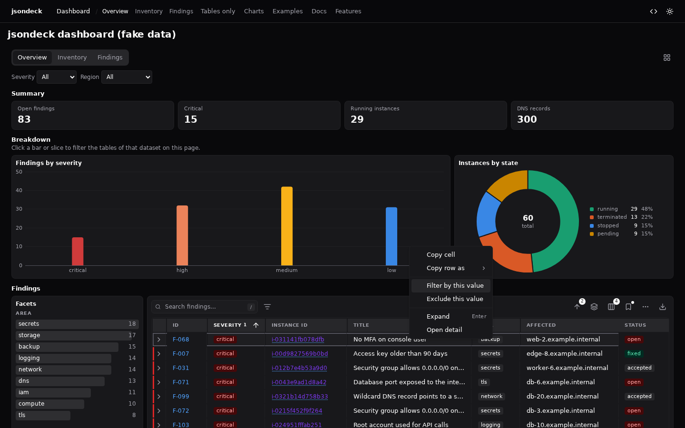 |

| Master-detail | Grouped table with totals |
|---|---|
| 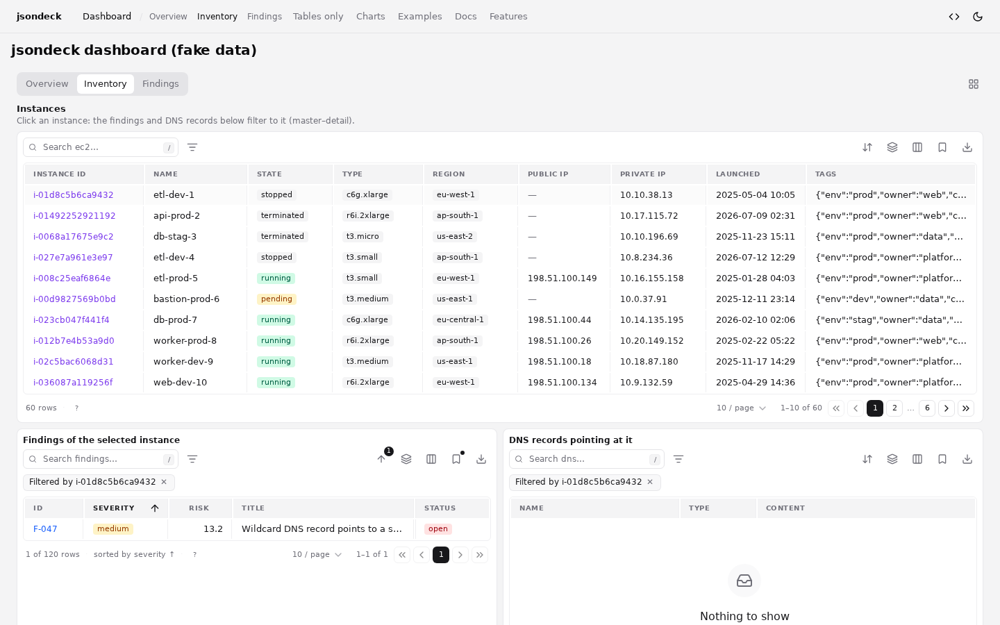 | 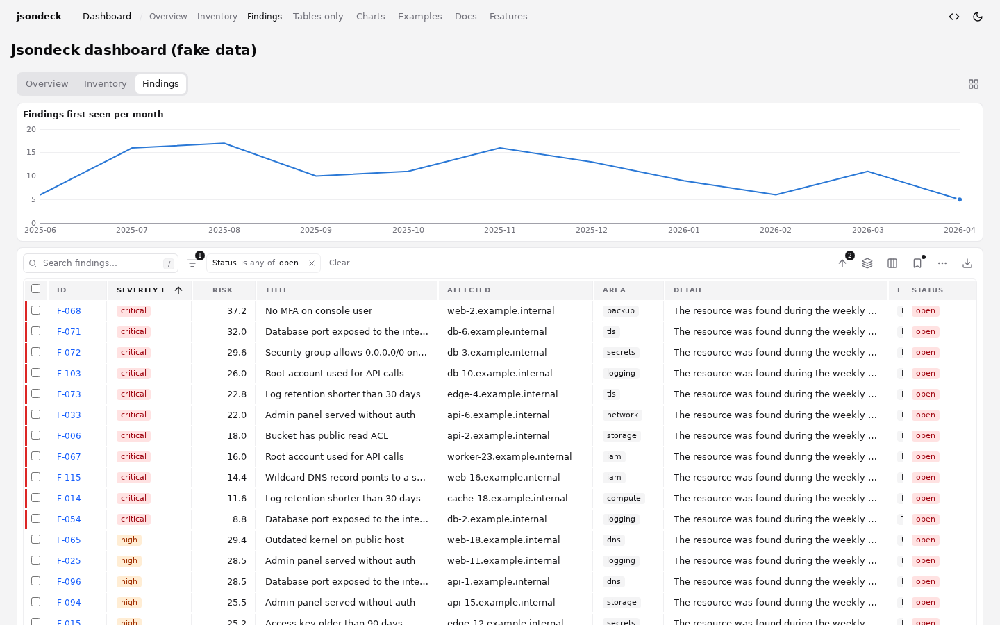 |

| Quick filters | Layout editor |
|---|---|
| 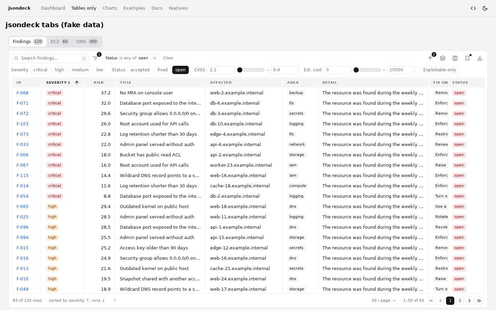 | 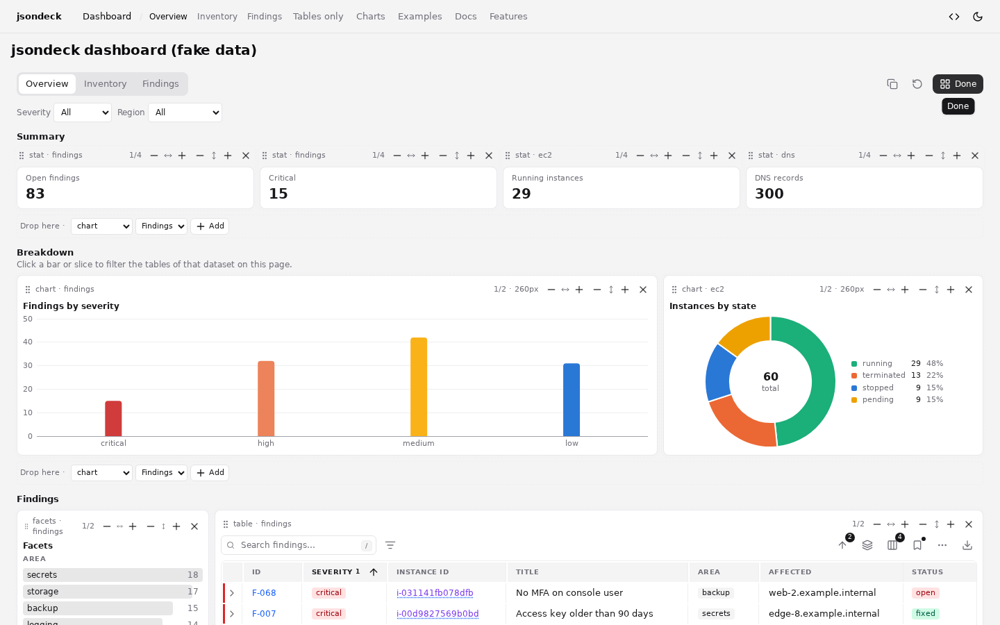 |

| Charts (light) | Charts (dark) |
|---|---|
| 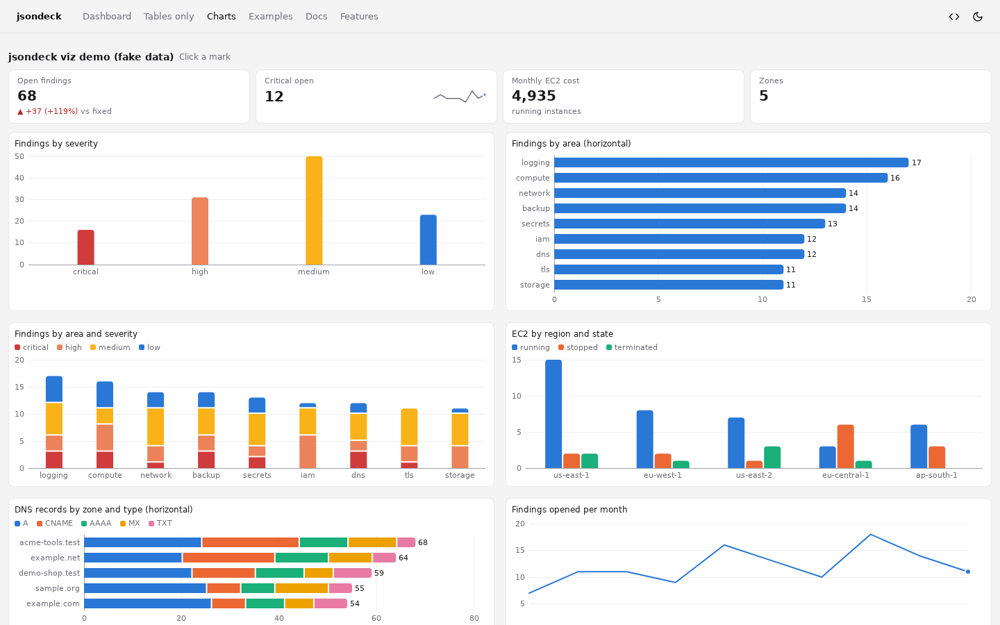 | 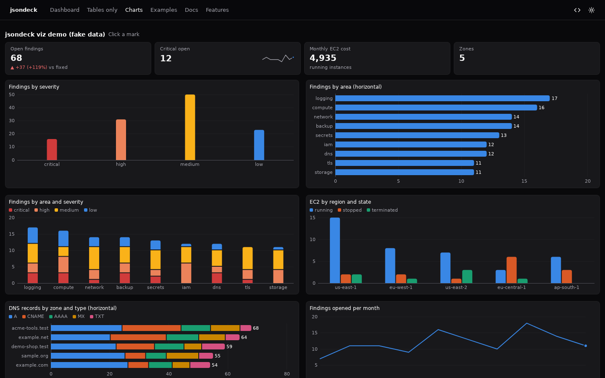 |

| Preview / Code examples | Theming: tokens and class names |
|---|---|
| 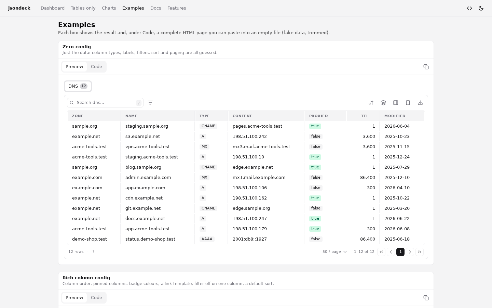 | 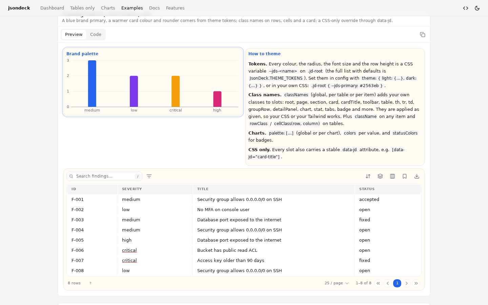 |

| Docs guide | Features list |
|---|---|
| 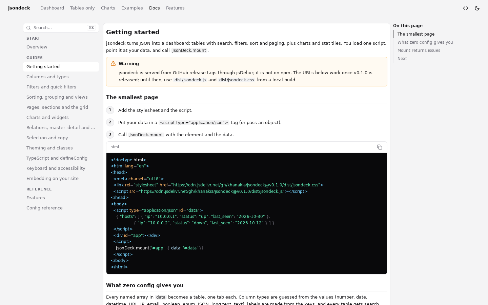 | 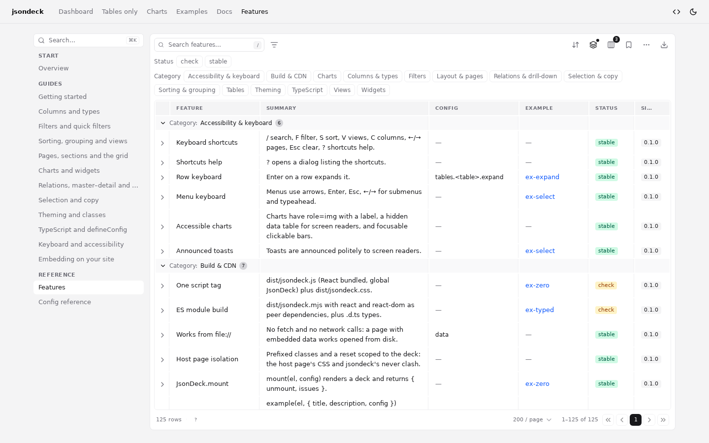 |

| Mobile |
|---|
| 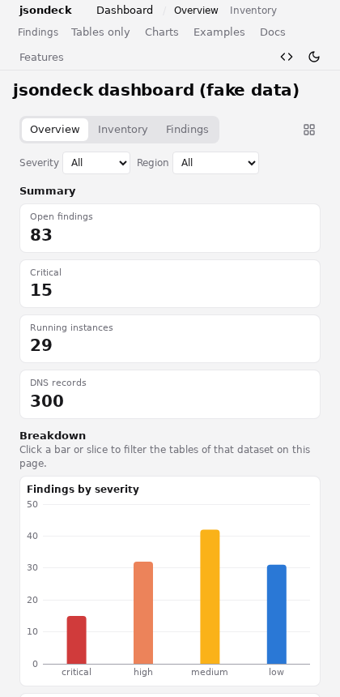 |

## FAQ

**What is jsondeck?**
A JavaScript library that turns JSON data into an interactive dashboard: data tables with filters, sort and pagination, plus charts, stat tiles and linked tables, from one `<script>` tag.

**Do I need React, a bundler or a server?**
No. `jsondeck.js` and `jsondeck.full.js` bundle React and run on any page; `jsondeck.full.js` also works on a page opened from disk with `file://`. Only the ES module expects you to provide React.

**Does it send my data anywhere?**
No. jsondeck makes no network calls. Data is read from a `<script type="application/json">` block or an object you pass in, and stays in the page.

**How do I show my JSON as a table with filters?**
Put the JSON in the page, add the script tag and call `JsonDeck.mount('#app', { data: '#data' })`. Every top-level array becomes a table with guessed column types, filters and paging.

**How much data can it handle?**
All rows are held in memory and the table shows one page at a time, so thousands to tens of thousands of rows are the comfortable range. There is no server-side data mode yet, and loading data from a URL is planned.

**Can I change the look?**
Yes: about 40 `--jds-*` color tokens with light and dark sets, 28 class-name slots, a `className` per item, row and cell classes and stable `data-jd` attributes. Dark mode follows `<html data-theme>`.

**Is it free for commercial use?**
Yes. jsondeck is MIT licensed, with no paid edition.

**Why not npm?**
For now jsondeck is published as tagged GitHub releases served by jsDelivr. An npm package may come later.

## Development

```sh
pnpm install
pnpm build        # dist/: jsondeck.js (loader) + chunks/, jsondeck.full.js, jsondeck.mjs + esm/, jsondeck.css, maps, types
pnpm typecheck    # strict TypeScript over src and the typed examples
task verify       # every headless browser check over http and file://
task size         # raw, gzip and brotli per file
```

`task --list` shows every command. The headless checks use Playwright's Chromium; if Chromium needs extra system libraries on your machine, set `LD_LIBRARY_PATH` in a git-ignored `.env.local`. Guides, the feature list and the config reference are in `docs/index.html`; live examples are in `demo/`. Changes per version are in `CHANGELOG.md`.

## How to release

```sh
task release:dry   # version, changelog, build, type check, every check, gitleaks, internal-info scan; nothing is committed
task release       # the same, then asks, commits, tags, pushes and creates the GitHub release
```

- Versions only ever go up by one patch number (`0.1.0`, `0.1.1`, `0.1.2`); `--bump minor` and `--bump major` are refused. The first release is `0.1.0` as written in `package.json`; after that, write the changes under `## [Unreleased]` in `CHANGELOG.md` and the script moves them under the new version.
- `main` never holds `dist/`. The script commits `release: vX.Y.Z` (version and changelog) on `main`, then makes one more commit on top of it, on no branch, that adds the built `dist/`, and points the tag `vX.Y.Z` at that commit. jsDelivr serves `https://cdn.jsdelivr.net/gh/khanakia/jsondeck@vX.Y.Z/dist/...` from the tag.
- The tag commit carries all of `dist/`, including `dist/chunks/` and `dist/esm/`, which `jsondeck.js` and `jsondeck.mjs` load from next to themselves; `task release:dry` lists every file going into the tag.
- It refuses a dirty tree or a branch other than `main`, and it is safe to run again: a tag made but not pushed is pushed, an existing GitHub release is left alone, and a released version is never released twice.
- The internal-info scan reads its patterns from `.git/info/release-denylist` or the `RELEASE_DENYLIST` environment variable.
- There is also a manual-only workflow, `.github/workflows/release.yml` (Actions → Release → Run workflow), which runs `node scripts/release.mjs --yes`.
- `--target cloudflare` (an R2 bucket through env vars) and `--target npm` are optional extra targets; `github` is the default.

## Next tasks

1. **Make it a proper docs site**:
   - a landing page with a live mini dashboard, a feature grid and a copyable install snippet
   - one shared header on every page: Docs · Components · Examples · Reference, ⌘K search, GitHub link, theme toggle, footer, and a hamburger menu on phones (today the navbar wraps onto three lines at phone width, see the mobile screenshot)
   - a Components section with one page per component (about 35), each with live Preview/Code examples, a generated options table, keyboard notes, related links and previous/next links
   - Examples and Reference (Features, Config reference, API) inside the same site
   - hash routes per page, a 404 page, per-page titles
   - `scripts/verify-site.mjs` that walks every route in light and dark
2. **First release:** make the GitHub repo public, run `task release` for `v0.1.0`, check the jsDelivr links, then mark the CDN and ESM features stable in `docs-content/features.json`.
3. **Page filter dropdowns:** restyle the page-level filter selects (Severity, Region…) to match the rest of the UI instead of plain browser selects.
4. **First-load size:** a plain table page now downloads about 115 kB of JavaScript, about 60 kB of it React DOM. Further savings would come from splitting more of the table core (the right-click menu items, saved views, the page editor state) or from a smaller calendar of our own (the date calendar chunk is about 21 kB gzipped).
5. **Saved views by URL:** share a saved view as a link.
6. **Load data from a URL:** today data must be embedded in the page or passed as an object.

## Contributing, security and license

- Contributing: [CONTRIBUTING.md](CONTRIBUTING.md). Everyone taking part follows the [Code of Conduct](CODE_OF_CONDUCT.md).
- Security issues: please report them privately, as described in [SECURITY.md](SECURITY.md).
- License: [MIT](LICENSE), © 2026 Aman Bansal.
